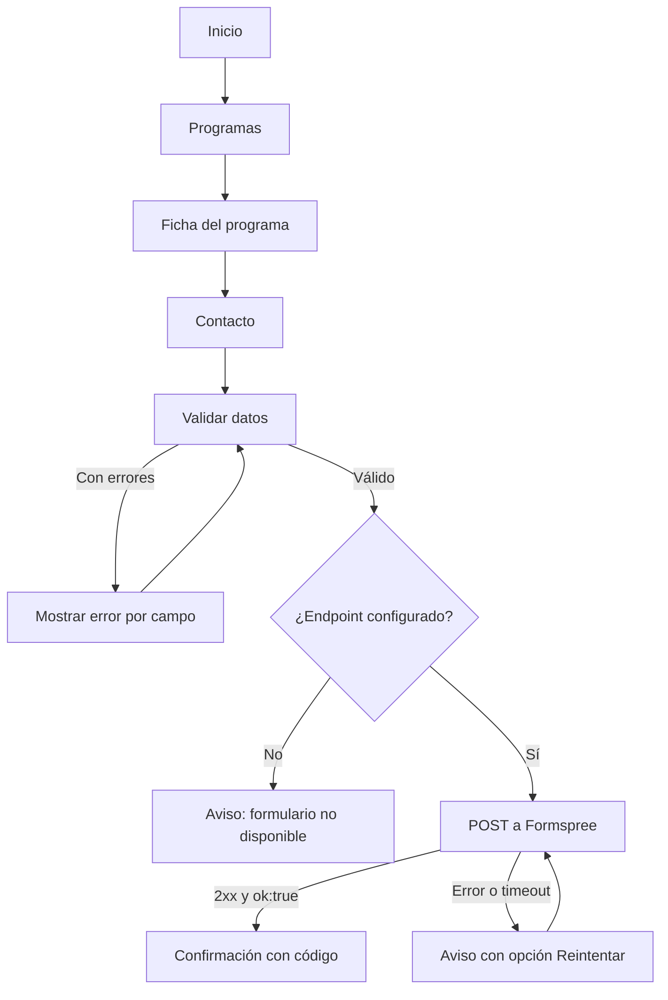
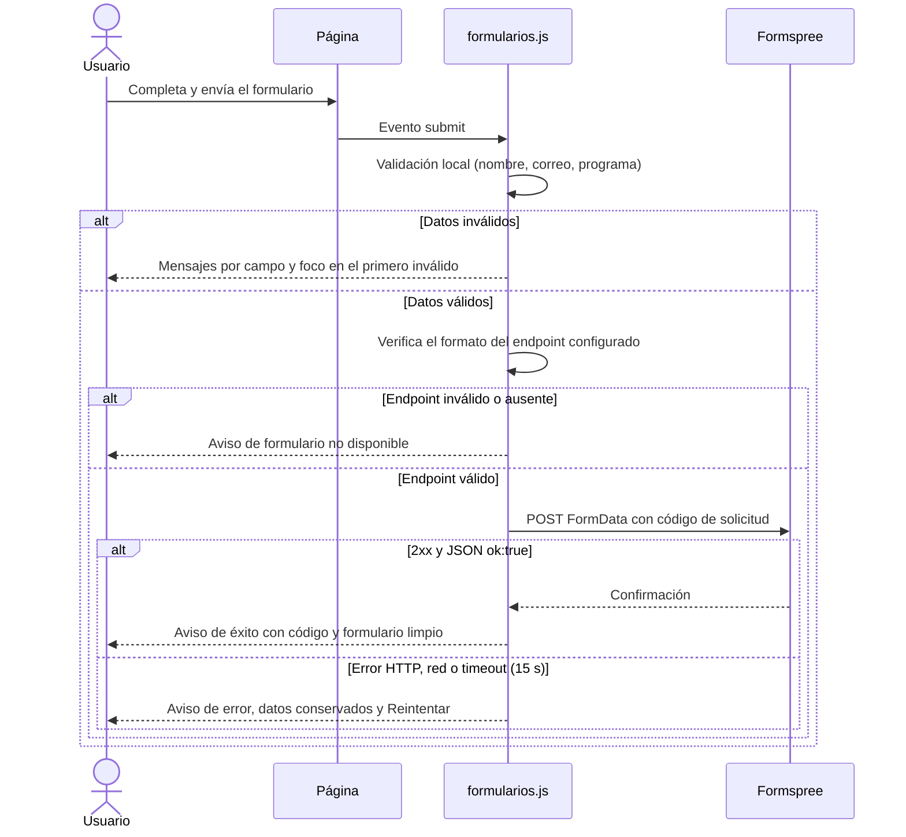
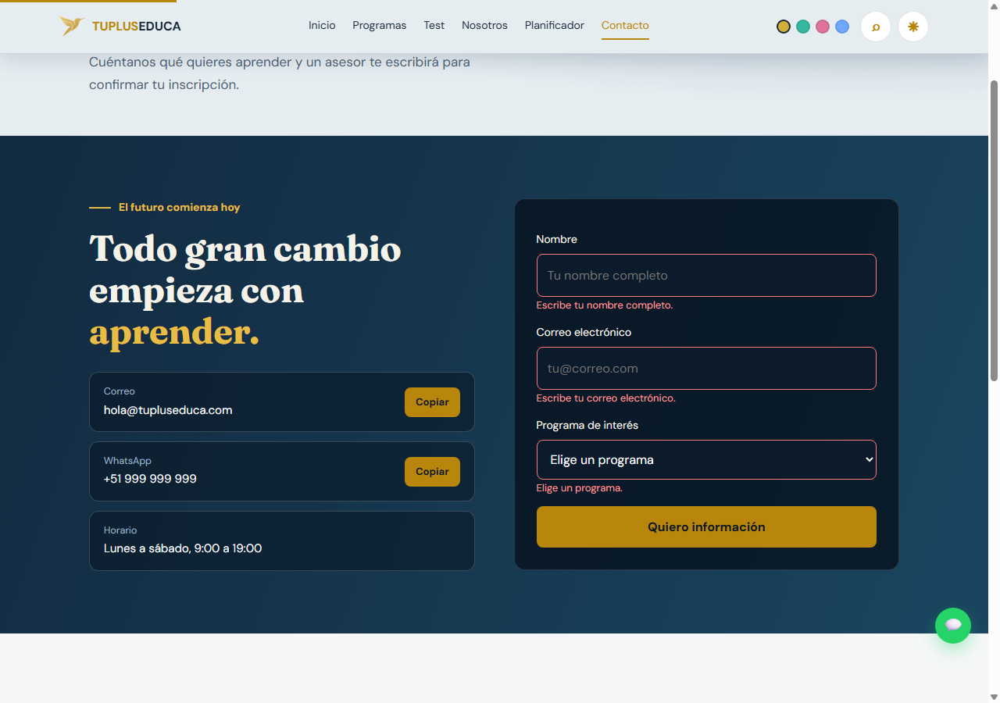
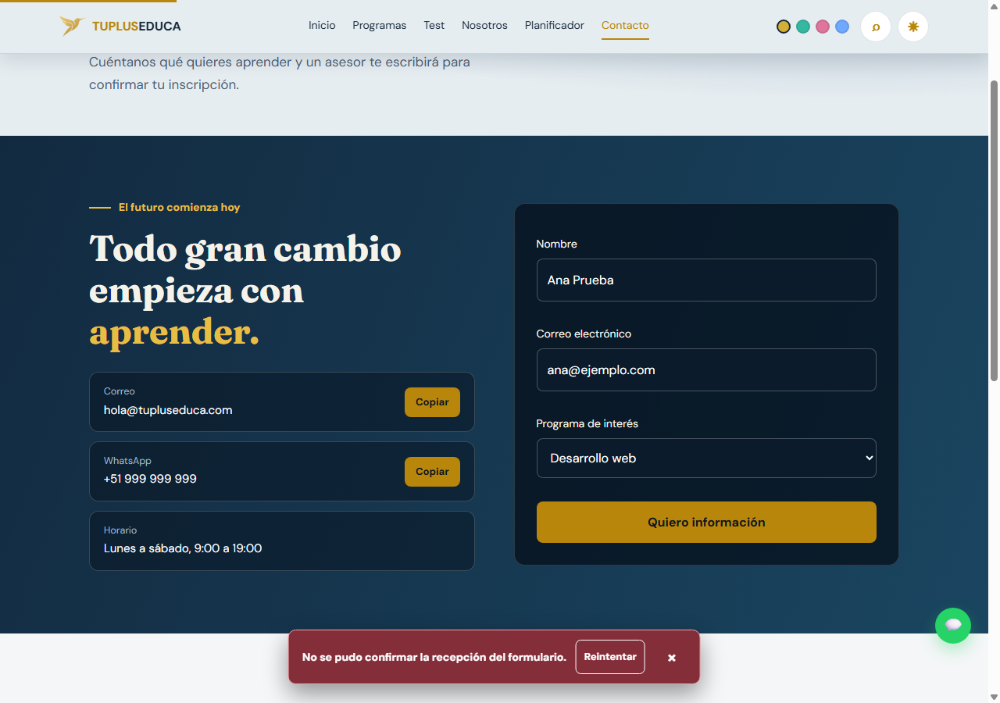
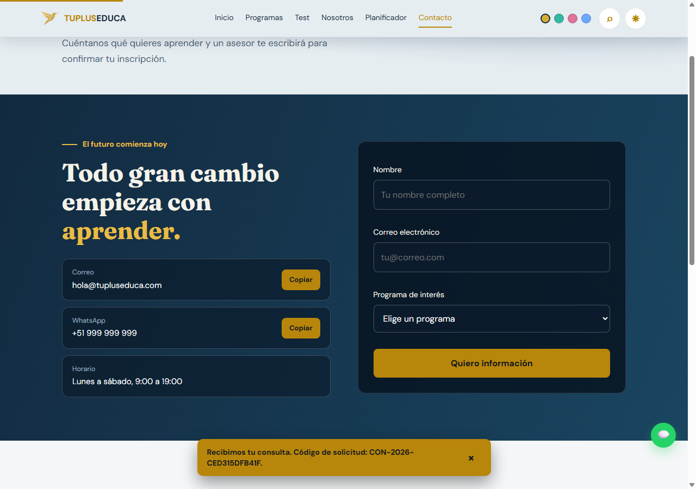

# TUPLUSEDUCA

Sitio web estático de captación para programas de formación. Incluye catálogo de programas, ficha de curso, test de afinidad, planificador de estudio, favoritos, buscador interno y un formulario de consulta conectado a Formspree.

No requiere backend ni base de datos: todo se ejecuta en el navegador y el formulario se entrega a un servicio externo (Formspree), que reenvía cada solicitud al correo configurado en su panel (por ejemplo, una cuenta de Gmail). No hay credenciales de correo en el código.

## Contenido

- [Stack y estructura](#stack-y-estructura)
- [Diagrama de flujo](#diagrama-de-flujo)
- [Variables de entorno](#variables-de-entorno)
- [Configuración](#configuración)
- [Ejecución local](#ejecución-local)
- [Pruebas](#pruebas)
- [Evidencias](#evidencias)
- [Solución de problemas](#solución-de-problemas)
- [Publicar en GitHub](#publicar-en-github)

## Stack y estructura

- HTML5, CSS3 y JavaScript moderno (vanilla, sin framework en el sitio).
- Datos de programas en `js/datos.js`; estado local con `localStorage` (tema, favoritos, respuestas del test).
- Formulario con validación en cliente y envío `fetch` a Formspree.
- Pruebas de comportamiento con Node.js (`assert` y `vm`), sin red ni credenciales.
- El repositorio incluye Vite para servir el sitio en desarrollo; la web publicada es estática.

```text
TUPLUSEDUCA/
├── index.html
├── 404.html
├── pages/
│   ├── programas.html      Catálogo y filtros
│   ├── curso.html          Ficha del programa
│   ├── test.html           Test de afinidad
│   ├── planificador.html   Cálculo de horas y fechas
│   ├── nosotros.html       Información institucional
│   └── contacto.html       Formulario de consulta
├── css/
│   ├── formularios.css     Avisos de envío y estados del formulario
│   └── ...                 Estilos base y por pantalla
├── assets/
├── js/
│   ├── datos.js               Programas, fichas y datos académicos
│   ├── utilidades.js          Helpers, avisos y descargas
│   ├── layout.js              Cabecera, pie y elementos flotantes
│   ├── comun.js               Tema, menú, buscador y boletín
│   ├── formularios-config.js  Endpoints públicos de Formspree
│   ├── formularios.js         Validación, envío y estados del formulario
│   ├── contacto.js            Inicializa el formulario de consulta
│   └── ...                    Lógica de cada pantalla
├── tests/
│   └── prueba_formularios_n2.cjs
├── docs/evidencias/           Capturas y salida de pruebas
├── .env.example
└── .gitignore
```

## Diagrama de flujo

### Recorrido del usuario



### Envío del formulario



El código de solicitud (`CON-AAAA-...` para consultas) se genera con `crypto.getRandomValues` y se conserva al reintentar mientras los datos no cambien. El motor también sabe emitir `SOL-AAAA-...` para solicitudes de matrícula, aunque esta versión del sitio solo publica el formulario de consulta.

### Datos que recibe Formspree

| Campo | Contenido |
| --- | --- |
| `nombre` | Nombre escrito por la persona |
| `email` | Correo de respuesta |
| `programa` | Nombre legible del programa elegido |
| `programa_id` | Identificador interno del programa |
| `tipo_solicitud` | `consulta_informacion` |
| `codigo_solicitud` | Código único de la solicitud |
| `_subject` | Asunto del correo con el código |

### Estados posibles del envío

| Situación | Mensaje visible | Reintento | Datos del formulario |
| --- | --- | --- | --- |
| Validación local | Error por cada campo | No aplica | Se conservan |
| Endpoint ausente o inválido | Formulario no disponible | No | Se conservan |
| HTTP 401, 403 o 404 | Formulario no disponible temporalmente | No | Se conservan |
| HTTP 429 | Demasiadas solicitudes | Sí | Se conservan |
| HTTP 400 o 422 | El servicio rechazó la solicitud | Sí | Se conservan |
| Otro error HTTP | No se pudo confirmar la recepción | Sí | Se conservan |
| Sin conexión | No hay conexión con el servicio + código | Sí | Se conservan |
| Timeout de 15 s | El envío tardó demasiado + código | Sí | Se conservan |
| Éxito (2xx y `ok:true`) | Confirmación con código | No | Se limpian |

## Variables de entorno

Este proyecto es estático y **no lee archivos `.env` en tiempo de ejecución**. La configuración efectiva del formulario vive en [`js/formularios-config.js`](js/formularios-config.js). La plantilla [`.env.example`](.env.example) existe como referencia para scripts de despliegue o automatización y no contiene secretos.

| Variable | Ejemplo | Uso |
| --- | --- | --- |
| `SITIO_BASE_URL` | `http://localhost:5500` | URL base para documentación o scripts de despliegue |
| `PUERTO_LOCAL` | `5500` | Puerto del servidor local (coincide con `.vscode/launch.json`) |
| `FORMSPREE_CONTACTO_URL` | `https://formspree.io/f/REEMPLAZAR_ID_CONTACTO` | Endpoint del formulario de consulta |
| `FORMSPREE_MATRICULA_URL` | `https://formspree.io/f/REEMPLAZAR_ID_MATRICULA` | Endpoint reservado para una futura página de matrícula |
| `ENTORNO` | `development` | Etiqueta del entorno de trabajo |

Reglas:

- Nunca subas un `.env` real: ya está excluido en [`.gitignore`](.gitignore).
- No escribas contraseñas, API keys ni tokens privados en estos archivos.
- Los identificadores de formulario de Formspree son públicos por diseño; la protección contra abuso se configura en el panel de Formspree (dominios permitidos, filtros de spam y límites).

## Configuración

### 1. Endpoint del formulario

1. Crea el formulario en [Formspree](https://formspree.io/).
2. Copia la URL, con el formato `https://formspree.io/f/<identificador>`.
3. Edita [`js/formularios-config.js`](js/formularios-config.js):

```js
window.TP_FORMULARIOS_CONFIG = Object.freeze({
  contacto: "https://formspree.io/f/TU_ID_DE_CONTACTO",
  matricula: "https://formspree.io/f/TU_ID_DE_MATRICULA"
});
```

El código solo acepta URLs con ese formato exacto; si falta o es inválida, muestra un aviso y no realiza la petición.

4. En el panel de Formspree, configura el correo de notificación (por ejemplo, tu Gmail), los dominios permitidos y las opciones antispam.

### 2. Datos de contacto visibles

Reemplaza los datos de ejemplo en [`pages/contacto.html`](pages/contacto.html):

- Correo `hola@tupluseduca.com`.
- WhatsApp `+51 999 999 999` (también en [`js/layout.js`](js/layout.js), enlace flotante).
- Horario de atención.

### 3. Fecha de la próxima cohorte

La cuenta regresiva se configura en [`js/inicio.js`](js/inicio.js):

```js
const INICIO = new Date("2026-12-01T09:00:00");
```

### 4. Catálogo y fichas de programas

Los programas, precios, módulos, docentes y reseñas se editan en [`js/datos.js`](js/datos.js). Las imágenes correspondientes están en `assets/`.

## Ejecución local

No uses `file://`: sirve el proyecto por HTTP para que el comportamiento sea equivalente al despliegue.

### Opción A: VS Code + Live Server

1. Instala la extensión **Live Server**.
2. Abre la carpeta del proyecto en VS Code.
3. Ejecuta **Open with Live Server** sobre `index.html`.
4. Abre `http://localhost:5500/`.

El archivo [`.vscode/launch.json`](.vscode/launch.json) ya apunta a `http://localhost:5500/index.html`.

### Opción B: servidor estático con Node.js

```bash
npx --yes http-server . -p 5500
```

o

```bash
npx --yes serve . -l 5500
```

Luego abre `http://localhost:5500/`.

### Opción C: Vite

```bash
npm install
npm run dev
```

Vite sirve el sitio en `http://localhost:5173/`.

Requisitos: Node.js 18 o superior para las pruebas; cualquier navegador moderno para el sitio.

## Pruebas

```bash
node tests/prueba_formularios_n2.cjs
```

La suite valida, sin red ni credenciales reales:

- Estructura de la página de contacto y del formulario.
- Errores obligatorios, correo inválido y foco accesible.
- Ausencia de peticiones cuando el endpoint no está configurado.
- Error HTTP 503, conservación de datos y reintento con el mismo código.
- Éxito únicamente con 2xx y `ok:true`.
- Códigos `CON-` y `SOL-`, consentimiento de matrícula y caída de red.

Salida esperada:

```text
TOTAL 34 pruebas correctas
```

La salida completa está en [`docs/evidencias/pruebas-formularios.txt`](docs/evidencias/pruebas-formularios.txt).

## Evidencias

Las capturas se generaron con Chrome headless contra el servidor local, simulando las respuestas de Formspree mediante `fetch`. **No se enviaron solicitudes reales.**

### Validación

Formulario vacío: se muestran los tres errores y el foco pasa al primer campo inválido.



### Error

Respuesta HTTP 503 simulada: aviso flotante de error, opción **Reintentar** y datos conservados.



### Éxito

Respuesta 2xx con `{ "ok": true }`: confirmación con código de solicitud y formulario limpio.



### Pruebas automatizadas

La salida completa de las 34 pruebas está en [`docs/evidencias/pruebas-formularios.txt`](docs/evidencias/pruebas-formularios.txt).

## Solución de problemas

| Síntoma | Causa probable | Acción |
| --- | --- | --- |
| El formulario muestra "no disponible" | Endpoint ausente o con formato distinto a `https://formspree.io/f/<id>` | Revisa `js/formularios-config.js` |
| "No disponible temporalmente" | Formspree devolvió 401, 403 o 404 | Verifica el identificador y los dominios permitidos |
| "Hay demasiadas solicitudes" | Límite de Formspree (HTTP 429) | Espera o revisa el plan de Formspree |
| "El servicio rechazó la solicitud" | Datos rechazados (HTTP 400 o 422) | Revisa los campos y la configuración del formulario |
| "No hay conexión con el servicio" | Red caída o URL inaccesible | Comprueba la conexión y el endpoint |
| "El envío tardó demasiado" | Sin respuesta en 15 s | Usa Reintentar; el código se conserva |
| Los cambios no se ven | Caché del navegador | Recarga con `Ctrl+F5` |
| No llegan los correos | Notificación o spam mal configurados | Revisa el panel de Formspree y la carpeta de spam |

## Publicar en GitHub

El proyecto ya es un repositorio Git. Desde la raíz:

```bash
git add .
git commit -m "Formulario de contacto con envío real, documentación y evidencias"
git push origin HEAD
```

Para publicar con GitHub Pages:

1. Entra en **Settings > Pages**.
2. En **Build and deployment**, elige **Deploy from a branch**.
3. Selecciona la rama que publicas y la carpeta `/ (root)`.
4. Abre la URL `https://<usuario>.github.io/<repositorio>/`.
5. Agrega ese dominio a los dominios permitidos del formulario en Formspree.

El [`.gitignore`](.gitignore) excluye `.env` y archivos temporales; solo se versiona `.env.example`.
